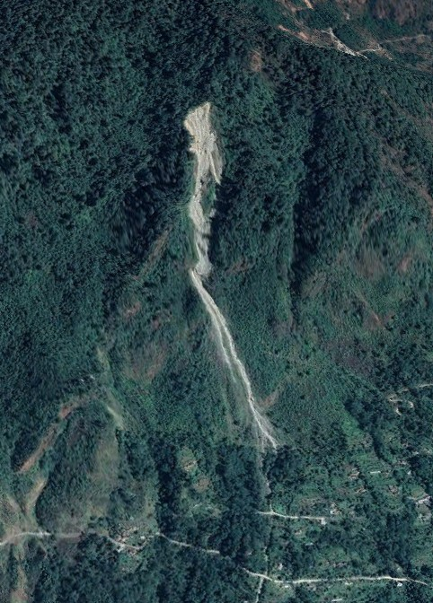
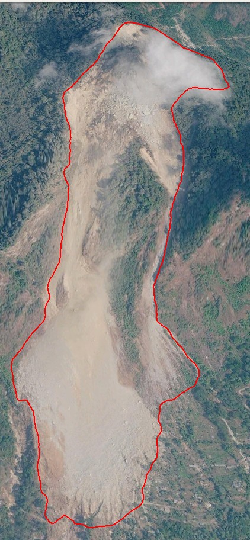
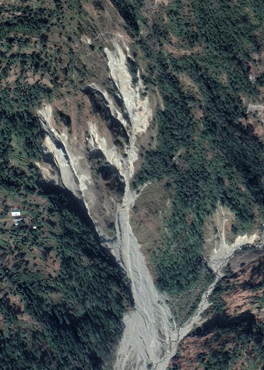
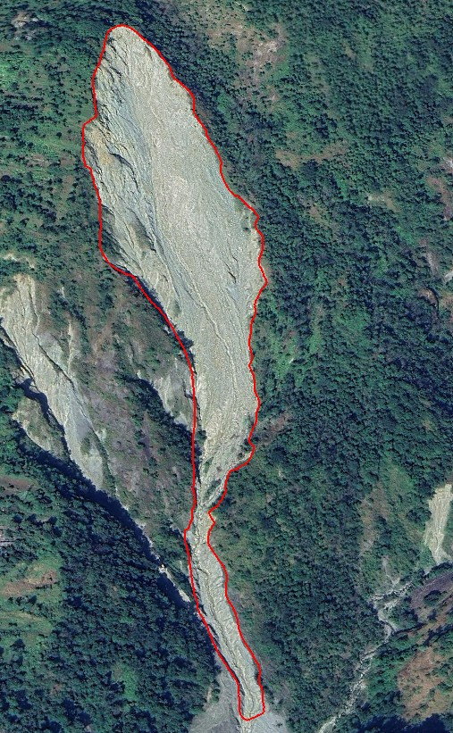
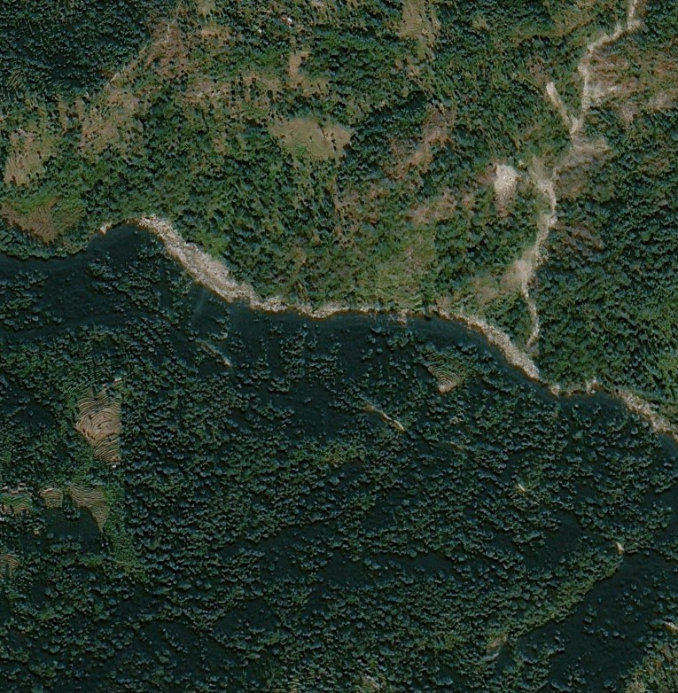
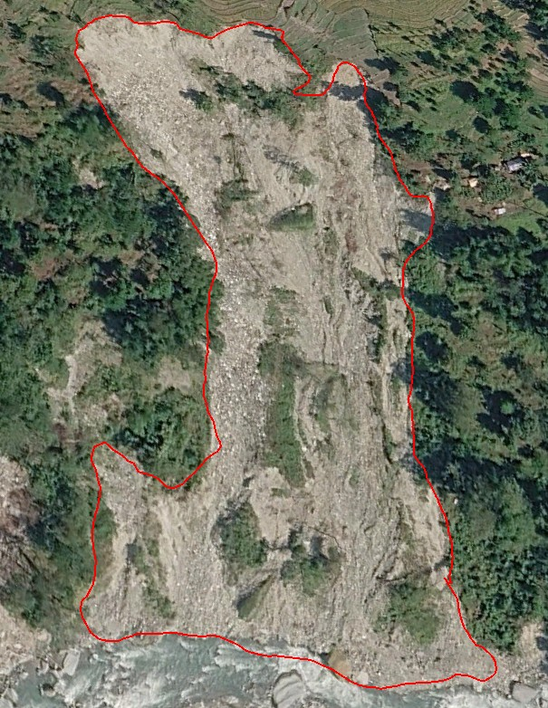
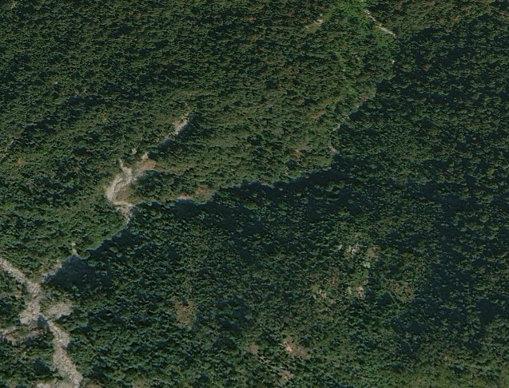
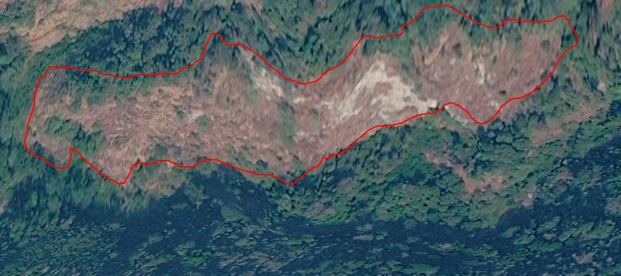
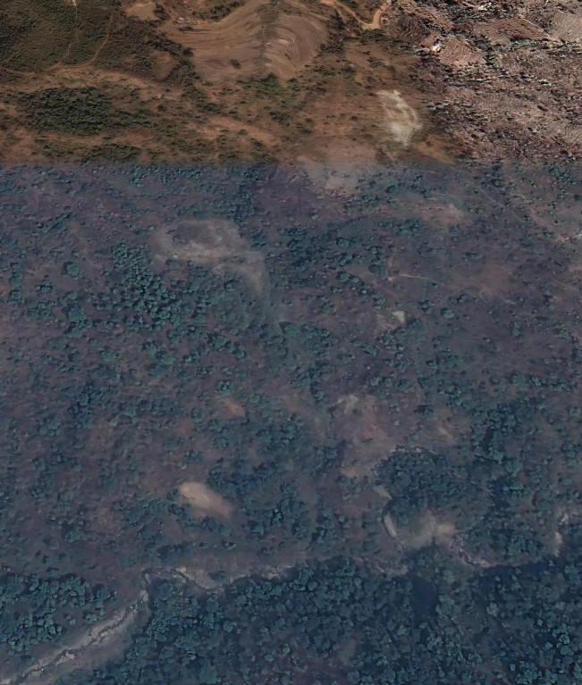
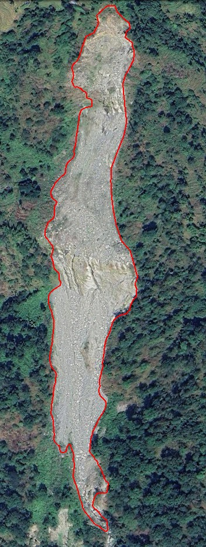

<p align="center">
  
</p>

<h1 align="center">Landslide Monitoring Model (LMM)</h1>

<p align="center">
  <strong>AI-Powered Soil Erosion Risk Mapping & Temporal Monitoring for India's Northeast</strong>
</p>

<p align="center">
  <a href="#methodology">Methodology</a> •
  <a href="#detection-results">Detection Results</a> •
  <a href="#classification">Classification</a> •
  <a href="#technology-stack">Tech Stack</a> •
  <a href="#development-timeline">Timeline</a> •
  <a href="#team">Team</a>
</p>

---

## Problem

India's Northeastern states face chronic landslide risk from monsoons and seismic activity, repeatedly severing the region's limited road and rail links. Existing landslide inventories are one-time snapshots — they detect a scar but never track whether it stabilises, stays bare, or keeps growing. **There is no operational system that continuously monitors the evolution of every mapped landslide over years.**

LMM addresses this by building a machine-learning pipeline that **identifies, maps, classifies, and temporally monitors** landslides from multi-temporal high-resolution satellite imagery spanning 2015 to the present.

---

## Methodology

The LMM pipeline is built as five sequential stages:


### 1. Data Acquisition

| Source | Resolution | Purpose |
|--------|-----------|---------|
| Copernicus Sentinel-2 | 10 m/pixel | Multi-temporal landslide detection |
| Landsat 7/8/9 | 10–30 m/pixel | Long-term temporal baseline (2015+) |
| Indian Remote Sensing (IRS) | 10–20 m/pixel | Regional mapping |
| Commercial VHR (procured) | < 1 m/pixel | Boundary refinement (LBM) |

### 2. Pre-Processing

- Cloud masking and filtering to retain only images where landslide scars are visible
- Orthorectification and co-registration of multi-temporal image pairs
- Radiometric normalisation for consistent spectral comparison

### 3. AI/ML Core — Bi-Temporal Change Detection

A **Siamese bi-temporal image transformer** (BIT / ChangeFormer architecture) is the detection backbone:

```
Input:  T0 image (pre-event) + T1 image (post-event)
Output: Pixel-level change map of landslide scars
```

- **Training data** — 100+ annotated T0–T1 pairs from known landslide-prone areas in Sikkim and Assam
- **Transfer learning** with a pre-trained backbone, heavy data augmentation, and iterative dataset expansion
- The model learns to separate genuine landslide scars from road cuts, construction, and mining through three false-positive filters:

| Filter | Mechanism |
|--------|-----------|
| **Road buffer** | Detections inside a buffer around NE road/rail shapefiles require higher confidence |
| **Slope threshold** | DEM-derived slope suppresses flat-terrain false positives |
| **Spectral check** | NDVI + red-band reflectance confirms bare soil inside each polygon |

### 4. Temporal Classification

Every detected landslide is classified into one of three categories using its **multi-year area-change curve** and **NDVI trend**:

| Class | Indicator | Action |
|-------|-----------|--------|
| 🟢 **Stable** | Vegetation re-growing inside the scar | Logged in inventory; low-priority monitoring |
| 🟡 **Non-Stable** | Bare soil persists; no vegetation recovery | Monitored at shorter intervals |
| 🔴 **Vulnerable** | Scar area actively growing year-on-year | High-priority alert; LBM boundary tracking engaged |

### 5. Landslide Boundary Modification (LBM)

The core innovation — an **edge-aware boundary refinement** algorithm applied on very-high-resolution (< 1 m) imagery:

1. Extract the **exact boundary pixels** of each landslide scar
2. Track those pixels across successive temporal images
3. Measure outward movement at the crown and flanks
4. **Raise an early-warning flag** when boundary displacement exceeds the configured threshold

> This provides the first-of-its-kind pixel-level early warning system for landslide reactivation.

---

## Detection Results

Below are satellite image pairs from the Sikkim region showing **before** (original satellite imagery from an earlier time period) and **after** (the same location at a later date, with LMM-detected landslide boundaries annotated in red).

### Site 1 — 27.3039°N, 88.3933°E (Sikkim)

<table>
  <tr>
    <th>Before (T0)</th>
    <th>After — LMM Annotated (T1)</th>
  </tr>
  <tr>
    <td></td>
    <td></td>
  </tr>
</table>

> An existing landslide scar visible in the earlier image has expanded dramatically. The red boundary delineates the full extent of the evolved landslide mass.

---

### Site 2 — 27.1398°N, 88.4719°E (Sikkim)

<table>
  <tr>
    <th>Before (T0)</th>
    <th>After — LMM Annotated (T1)</th>
  </tr>
  <tr>
    <td></td>
    <td></td>
  </tr>
</table>

> A large debris flow channel with active erosion. The annotated boundary captures the full scar from crown to toe.

---

### Site 3 — 27.3308°N, 88.2665°E (Sikkim)

<table>
  <tr>
    <th>Before (T0)</th>
    <th>After — LMM Annotated (T1)</th>
  </tr>
  <tr>
    <td></td>
    <td></td>
  </tr>
</table>

> A region that appeared stable with dense vegetation cover in the earlier image now shows a massive landslide complex. The red boundary captures the irregular erosion front.

---

### Site 4 — 27.313°N, 88.379°E (Sikkim)

<table>
  <tr>
    <th>Before (T0)</th>
    <th>After — LMM Annotated (T1)</th>
  </tr>
  <tr>
    <td></td>
    <td></td>
  </tr>
</table>

> Dense forest cover in the before image with only minor bare patches. The annotated image reveals a lateral spread of erosion along the ridge, detected by LMM boundary analysis.

---

### Site 5 — 27°00′14.76″N, 88°29′38.38″E (Sikkim)

<table>
  <tr>
    <th>Before (T0)</th>
    <th>After — LMM Annotated (T1)</th>
  </tr>
  <tr>
    <td></td>
    <td></td>
  </tr>
</table>

> A narrow elongated landslide scar with the red boundary precisely tracing the debris flow channel from head scarp to deposition zone.

---

## Technology Stack

| Layer | Technology |
|-------|-----------|
| **ML Framework** | PyTorch (multi-GPU training) |
| **Model Architecture** | Siamese Bi-Temporal Image Transformer |
| **Training Infrastructure** | PARAM Vikram-1000 HPC, PRL Ahmedabad |
| **Database** | PostgreSQL / PostGIS |
| **Map Services** | GeoServer (WMS/WFS) |
| **Backend API** | FastAPI (REST) |
| **Frontend** | React + OpenLayers / Leaflet |
| **Alerts** | Email / SMS gateway |
| **Data Formats** | Shapefile, KML, GeoJSON, GeoTIFF |

---

## Development Timeline


| Milestone | Date | Deliverable |
|-----------|------|-------------|
| LMM Training Complete | 25 Dec 2026 | Trained bi-temporal transformer |
| Early Prototype | 15 Jan 2027 | Preliminary results from Sikkim |
| Prototype | 31 Jan 2027 | Sikkim + Assam results; trained model |
| MVP | 1 May 2027 | Full landslide database, temporal evolution history, dashboard |

---

## Validation Strategy

- **Cross-validation** against existing GSI and NRSC/ISRO landslide inventories
- **Manual expert review** of every detection, including temporal evolution analysis
- **Field visits** for newly discovered, previously unreported landslides
- **Pilot regions**: Sikkim (primary), Assam (secondary)

---

## Team

| Role | Name | Affiliation |
|------|------|-------------|
| **Student** | Vyshak Sanil | B.Tech ECE (3rd Year), SJCET Palai, Kerala |
| **Student** | Rathinam Ramasamy J | B.E Geoinformatics (4th Year), Anna University, Chennai |
| **Faculty** | Dr. Giby Jose | Assoc. Prof. & HOD, ECE, SJCET Palai |
| **Faculty** | Ms. Shilpa Lizbeth George | Asst. Prof., SJCET Palai |
| **Mentor** | Dr. Vijayan S | Assoc. Prof., Physical Research Laboratory, Ahmedabad |

---

## Data Sources

- **Copernicus Sentinel-2** — ESA (Open Access)
- **Landsat 7/8/9** — USGS (Open Access)
- **Indian Remote Sensing Satellites** — ISRO/NRSC
- **Very High-Resolution Imagery** (< 1 m/pixel) — to be procured for selected regions

---

## License

This project is developed for research purposes in collaboration with the Physical Research Laboratory (PRL), Ahmedabad.

---

<p align="center">
  <sub>Built with 🛰️ by the LMM Team — towards safer roads and lives in India's Northeast</sub>
</p>
